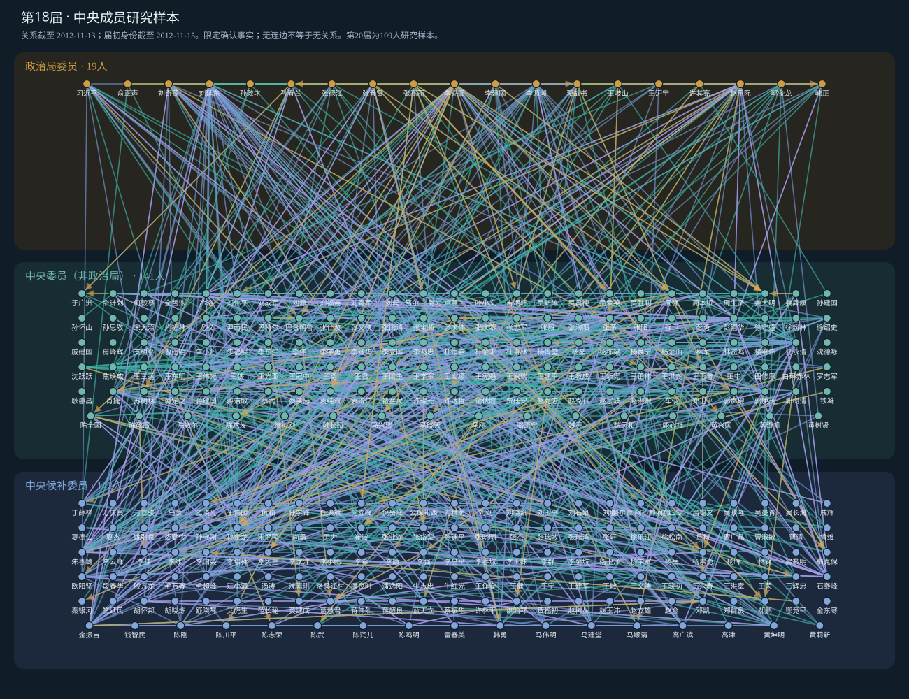

# 第15—20届中央成员三层关系网络

**基于已确认事实的限定范围研究网络。** 本项目展示现有研究名单中人物之间的历史共事、直接上下级及校友联系。身份决定显示层，经历与证据决定是否连边。

数据冻结版本：2026-10-16；项目页整理：2026-10-20。仓库：https://github.com/siyangzhu-art/central-member-network 。项目网页：https://siyangzhu-art.github.io/central-member-network/ （启用GitHub Pages后生效）。

## 项目概况

| 项目 | 范围 |
|---|---|
| 人物总名册 | 889人 |
| 人物—届次节点 | 1,542条，15—20届共六张图 |
| 确认关系 | 4,499条，按届次及关系类型计，不是唯一联系人总数 |
| 四类关系 | 共事1,486；直接上下级435；同期校友589；一般校友1,989 |
| 冻结研究库确认事实范围 | 12,826条；9,095条具备本轮连边输入条件 |
| 严格网络候选边 | 0条；未确认事实与候选关系不进入严格网络 |
| 第20届 | 既有109人研究子样本，不是完整中央成员名单 |
| 完整生涯／回归就绪 | 未证明完整；`regression_ready=false` |

## 浏览方式

GitHub Pages 首页为项目说明；点击“打开六届交互网络”进入网络。也可在本地用浏览器打开 `docs/index.html` 或 `docs/network.html`，无需安装依赖。

交互功能：切换届次、搜索姓名、四类关系独立筛选与组合、点击人物高亮邻居、点击关系查看双方原文摘录和原网站、至少六个月筛选、当时共事筛选、缩放平移、导出当前SVG。证据面板可能只展示一条边的部分依据，完整列示的关系依据见下载包。此发布版不提供本机缓存路径链接。

## 三层节点与时间截点

当届政治局委员（含常委）置上层；非政治局的正式中央委员居中；中央候补委员置下层。每人每届仅一个显示节点，原有身份字段保留；孤立节点不删除。跨届换层不等于形成新的历史联系。

主图累计到该届中央委员会选举前一日已经形成的历史关系，按该届届初最终身份分层。关系截点与身份日期分别展示：

| 届次 | 节点 | 确认边 | 关系截至 | 身份截至 |
|---|---:|---:|---|---|
| 15 | 268 | 466 | 1997-09-17 | 1997-09-19 |
| 16 | 272 | 600 | 2002-11-13 | 2002-11-15 |
| 17 | 295 | 862 | 2007-10-20 | 2007-10-22 |
| 18 | 302 | 1172 | 2012-11-13 | 2012-11-15 |
| 19 | 296 | 1172 | 2017-10-23 | 2017-10-25 |
| 20 | 109 | 227 | 2022-10-21 | 2022-10-23 |

本包发布CC主截面。完整本地档案另含PB选举分析截面，本页没有将两者相加。后来发布的资料可证明早先事实，后来发生的经历不得回填。

## 四类联系定义

| 类型 | 条件 | 方向 |
|---|---|---|
| 共事 | 同一具体机构或有证据的领导班子，任职时间确定重叠 | 无向 |
| 直接上下级 | 同期有证据的直接组织领导关系 | 上级→下级 |
| 同期校友 | 普通高校学历教育，同校且在校时间确定重叠 | 无向 |
| 一般校友 | 普通高校学历教育，同校，不要求同期 | 无向 |

同一对人可同时具有多种关系。同期校友包含在一般校友中，组合联系人统计须去重。普通高校在职学历纳入并标记；党校、军校、短训、访问、博士后和名誉学位排除。校友关系不证明私人交往或共同到校；历史共事也不证明关系持续至今。

同省不同单位不自动算共事，职级高低或图上层次不证明直接上下级。主网络不设最低共事时长，但必须确定存在正时长重叠；仅有交接边界不自动连边。六个月筛选使用已确认重叠下界，一般校友不附加同期要求。

## 核实与冲突处理

先确认人物，再对齐具体事件，最后比较来源。优先采用直接记载该事件的正式任免、生效、选举或授位文件，再参考官方履历、院校记录、可靠原始报道；百科辅助，转载不视为独立证据。

一处未提及而另一处明确记载属于信息互补，须先确认人物和事件归属。双方明确到月份且差异不超过六个月，只标轻微差异，不能因此扩大任期。跨年差异仍检查年度变量；仅年份不同不能猜月份。任命、到任、生效、学习、毕业、授位分开处理；缺结束日期不补造。

真实冲突保留原值、来源与理由；未决事实从最终事实表和网络输入排除。冻结本地档案保留排除的4,889条事实范围和8,620条网络输入范围（两种口径不同），以及不确定截点形成时间的122条CC/PB关系记录。网络CSV与交互图只列严格网络及其确认依据。另附Excel在独立工作表中保留未决和排除范围、基本字段候选及冲突候选，不能将这些档案并入确认网络；未删除本地原始资料，也不把排除解释为证伪。

## 覆盖、指标与解释限制

839人有足以进入本轮连边的确认经历；其余50人保留节点。覆盖不是全生涯完成率。无可用经历的相应指标保留缺失；0仅表示当前确认资料记录到0位联系人，不能理解为现实无关系。图中同时显示的当届最终身份只服务描述，不可直接拿来构造解释当届晋升的事前变量。

`metrics_cc.csv` 保留关系分类、直接上级/下级、分层联系人、唯一联系人及覆盖/排除标记。`*_to_pb/cc/alt` 涉及当届显示身份；`*_prev_*` 也须结合前期身份依据和缺失标记使用，不能仅凭列名认定不存在未来信息。本项目不将这些指标声明为已经可以直接投入回归。

## 下载与文件

- [官员数据库 Excel](docs/downloads/officer-database.xlsx)：约10.2 MB，参照CPED结构，16个工作表。含889人基本信息、12,826条确认经历范围、4,889条未决及排除范围、人物届次、网络与来源证据。
- [Excel独立复核报告](docs/downloads/excel-review.md)及[逐项检查结果](docs/downloads/excel-audit.json)：43项检查通过；直接比较原CSV的880,185个字段值，未发现导出差异。
- [Excel原导出验收](docs/downloads/excel-export-validation.json)及[文件SHA256](docs/downloads/officer-database.xlsx.sha256)。

**Excel的使用边界：**“全部经历”和严格网络只包含已确认范围；“基本信息”和“人物届次”仍保留带状态标记的报告值或候选。未决与排除信息在独立工作表归档，不得作为确认事实或直接并入网络。没有本轮确认经历的4人仍保留在总名册，另外46人虽有确认描述但不足以支持网络输入。本次加入的是通过复核的同一份Excel，文件散列不变。

- [数据与图形压缩包](docs/downloads/network-data.zip)：7张CSV（节点、CC确认边、对应关系证据、CC指标、覆盖、CC分层汇总、变量字典）、24个GraphML、6张SVG。
- [冻结版本验收结果](docs/downloads/final_validation_report.json)：原研究版本验收记录，不是本次新做原文复核。
- [冻结版本完成报告](docs/downloads/final_completion_report.json)。
- [发布版完整性检查](PUBLICATION_VALIDATION.json)：本次仅验证导出、证据链接、页面与冻结网络一致。

CSV证据表保留正文摘录和原网站URL；Excel另行归档未决、排除与候选信息并保留原状态。完整网页缓存、原始回归输入及内部执行日志仍保留在本地完整研究档案，不在网页发布包内。数据包不包含CPED省市数据库。项目包不含可重新采集、裁定和构建全部研究数据的完整流水线，不能据此声称研究全流程可复现。

原冻结版本验收：112项语义反例通过、12个CC/PB截点指标复算一致、29组CSV/Stata回读一致、24个GraphML回读、17份受保护回归输入散列不变。本次发布整理不重复来源检索、不新增确认事实。

## 上传到GitHub并启用项目页

1. 新建或选择仓库，将此文件夹**内部文件**上传到仓库根目录；ZIP需先解压，不能只上传ZIP期待自动展开。
2. 仓库中应直接出现 `README.md` 和 `docs/`；不要多嵌一层文件夹。
3. 进入 **Settings → Pages → Build and deployment → Source: Deploy from a branch**。
4. 选择 **main** 分支、**/docs** 目录，点击 **Save**；分支名称不同则选择实际分支。
5. 发布后在Pages设置中点击 **Visit site**，把生成的网址分享给他人。项目网站通常形如 `https://用户名.github.io/仓库名/`。

说明依据：[创建GitHub Pages网站](https://docs.github.com/en/pages/getting-started-with-github-pages/creating-a-github-pages-site)、[配置发布来源](https://docs.github.com/en/pages/getting-started-with-github-pages/configuring-a-publishing-source-for-your-github-pages-site)。本包使用相对路径及 `.nojekyll`，不需要构建命令或外部脚本。

## 引用与使用

建议引用：**《第15—20届中央成员三层关系网络：基于已确认事实的限定范围研究样本》，数据冻结2026-10-16，发布整理2026-10-20。** 正式发表时补充项目负责人、仓库网址和访问日期；引用某项事实时同时引用其原始来源。未替研究者填入作者姓名或授予新的开放许可证，第三方来源材料保留原权利。
